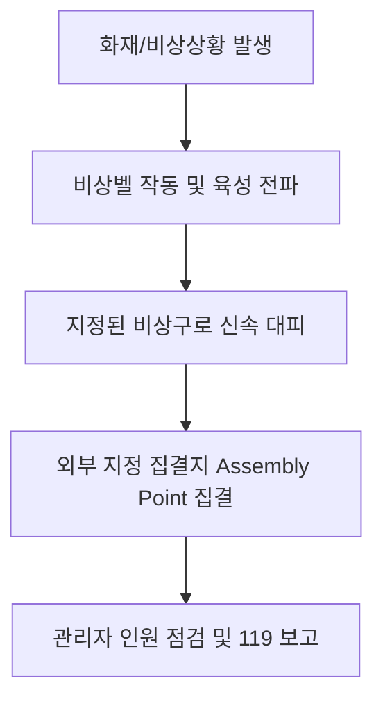
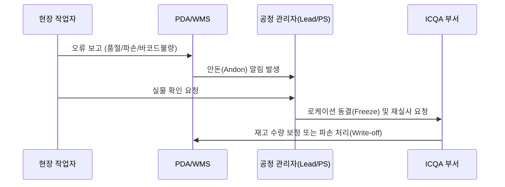

# 📦 스마트 물류센터 신규 입사자 온보딩 가이드북

환영합니다! 본 가이드는 물류창고 신규 입사자가 현장 업무에 신속하고 안전하게 적응할 수 있도록 설계된 표준 온보딩 매뉴얼입니다.

---

# [Chapter 1] 회사 소개 및 물류센터(FC) 개요

## 1.1 센터 비전 및 핵심 가치
- **정확성(Accuracy)**: 고객에게 약속된 상품을 정확하게 전달합니다.
- **신속성(Speed)**: 최적화된 동선과 스마트 물류 시스템을 기반으로 정시 출고를 실현합니다.
- **안전 제일(Safety First)**: 어떠한 생산성 지표보다 작업자의 안전과 건강이 최우선입니다.

## 1.2 물류센터 전체 조감도 및 구역 구분

- **입고(Inbound) 구역**: 벤더사 차량 접안 및 팔레트 단위 하역/검품
- **보관(Storage) 구역**: 랙(Pallet/Mezzanine Rack) 보관 및 자동화 설비 구역
- **출고(Outbound) 구역**: 오더 피킹(Picking), 패킹(Packing), 오토배거(Auto Bagger) 운영 구역
- **분류 및 상차 구역**: 권역별 소터(Sorter) 및 최종 간선 차량 적재 Dock
- **편의 및 관리 구역**: 휴게실, 안전보건실, 중앙관제센터(TOC), 사무동

## 1.3 기본 근무 수칙 및 복장 규정
- **복장 규정**:
  - 안전화 필수 착용 (미착용 시 작업장 진입 불가)
  - 반사 조끼(High-Visibility Vest) 및 명찰 패용
  - 헐렁한 옷, 긴 목걸이, 늘어진 끈 금지 (기계 끼임 방지)
  - 긴 머리는 안전모 또는 헤어망 안으로 단정히 묶을 것
- **반입 금지 물품**:
  - 개인 전자기기 (중앙관제 승인 기기 외 스마트폰 현장 휴대 제한)
  - 커터칼(개인용) 금지 (반드시 센터 지급 안전칼만 사용)
  - 라이터, 인화성 물질, 유리병 음료

---

# [Chapter 2] 안전보건 가이드 (Safety First)

> [!CAUTION]
> 지게차와 작업자의 동선 분리는 생명과 직결됩니다. 반드시 보행자 전용 통로(Green Zone)로만 이동하십시오.

## 2.1 지게차 및 중장비 안전 수칙
- **보행자 통행 규칙**: 녹색 보행로 준수, 교차로 진입 시 **'좌우 확인 후 지적확인'**
- **안전 반경 유지**: 작업 중인 지게차 및 리치 트럭 반경 **3m 이내 접근 절대 금지**
- **사각지대 경고**: 코너 미러(볼록거울) 확인 및 경광등/후진 알람 주의

## 2.2 중량물 취급 및 근골격계 예방 작업 지침
1. **중량물 취급 3원칙**:
   - 단독 리프팅 한도: 남성 20kg 이하, 여성 15kg 이하
   - 초과 중량물: 반드시 2인 1조(Team Lift) 또는 운반 대차(Hand Pallet) 활용
2. **올바른 들어올리기 자세**:
   - 물건에 몸을 최대한 밀착
   - 허리를 펴고 무릎을 굽힌 상태에서 하체 힘으로 기립
   - 몸을 비틀면서 들어 올리지 말 것

## 2.3 비상 대응 및 화재 대피 요령

- **소화기/비상정지버튼(E-Stop)** 위치 숙지 (컨베이어 라인마다 5m 간격 배치)
- 비상구 주변 1m 이내 상품 적재 절대 금지

---

# [Chapter 3] 기본 시스템 및 장비 사용법 (PDA / WMS)

## 3.1 창고 관리 시스템(WMS) 개념
- **WMS(Warehouse Management System)**: 입고, 적재, 재고 이동, 피킹, 출고까지의 모든 물류 흐름을 실시간으로 추적·제어하는 중추 전산 시스템입니다.

## 3.2 PDA(바코드 스캐너) 기본 조작
1. **로그인**: 사번 바코드 스캔 $\rightarrow$ 비밀번호 입력 $\rightarrow$ 당일 배정 공정(IB/OB/ICQA) 선택
2. **배터리 관리**:
   - 잔여 배터리 20% 이하 시 충전실에서 완충 배터리로 교체
   - 교체 시 반드시 전원 OFF 후 배터리 분리
3. **스캔 오류 대응**:
   - 바코드 훼손 시: 수기 입력(Manual Input) 기능 활용 후 즉시 ICQA/바코드 재발행 요청
   - 네트워크 단절 시: 와이파이 음영 구역을 벗어나 리로드(Reload)

## 3.3 로케이션(Location) 바코드 체계 이해
창고 내 모든 선반과 바닥은 8자리 표준 코드로 관리됩니다.

$$\mathbf{A}\text{-}\mathbf{03}\text{-}\mathbf{12}\text{-}\mathbf{04}$$

| 구분 | 기호 | 의미 | 예시 설명 |
| :--- | :---: | :--- | :--- |
| **Zone** | `A` | 알파벳 구역명 | 입고 A구역 |
| **Aisle** | `03` | 통로 번호 | 3번 통로 |
| **Bay** | `12` | 랙 기둥 번호(수평) | 12번째 랙 베이 |
| **Level** | `04` | 단 수(수직 선반) | 4번째 선반 높이 |

---

# [Chapter 4] 입고(Inbound) 및 재고 보관(Stow) 프로세스

## 4.1 하역 및 입고 검품
- **송장 대조**: 납품서(ASN) 품목, 수량, 유통기한 일치 여부 확인
- **외관 검수**: 박스 파손, 습기 침투, 밀봉 씰 훼손 여부 확인 (파손품은 Reject 존 이동)
- **바코드 부착**: 미등록 단품의 경우 센터 전용 UPC/SKU 바코드 부착

## 4.2 적재 및 보관(Stow) 원칙
- **선입선출(FIFO)**: 입고 일자 및 소비기한이 빠른 상품을 전면에 배치
- **골든존(Golden Zone) 배치**:
  - **하단(Heavy)**: 무거운 상품 (허리 부상 방지 및 선반 하중 안정화)
  - **중단(Golden)**: 회전율이 높은 상위 품목 (가장 손이 닿기 쉬운 가슴~허리 높이)
  - **상단(Light)**: 부피가 크고 가벼운 상품
- **오버행(Overhang) 금지**: 랙 선반 밖으로 상품이 5cm 이상 튀어나오지 않도록 정렬

---

# [Chapter 5] 출고(Outbound) 프로세스: 피킹 & 패킹

## 5.1 집하(Picking) 프로세스
- **오더 수주 및 토트(Tote) 매핑**: PDA에서 피킹 지시서(Pick List) 활성화 후 빈 토트 스캔
- **동선 최적화**: WMS가 지정하는 최단 동선(S자형 동선)을 따라 이동
- **3중 확인 원칙**:
  1. 로케이션 바코드 스캔
  2. 상품 바코드 스캔
  3. 지시 수량 확인 후 토트에 투입

## 5.2 포장(Packing) 및 완충재 규정
- **송장-상품 매치 검증**: 최종 출하 검품 스캔(Scan-to-Pack)
- **포장 부자재 기준**:
  - 파손 위험품(유리, 화장품, 전자기기): 에어캡(버블랩) 최소 2회 래핑
  - 의류/비파손품: 친환경 폴리백(Polybag) 적용
  - 일반 박스: 공간의 20% 이상 빈 공간 발생 시 에어쿠션(Dunnage) 충진
- **밀봉 및 테이핑**: 박스 중앙 'H자형 테이핑'으로 하중 지지력 극대화

---

# [Chapter 6] 재고 관리(ICQA) 및 예외 처리

## 6.1 ICQA(Inventory Control & Quality Assurance)
- **주기적 순환 실사(Cycle Count)**: WMS 로케이션과 실제 재고의 일치율(Net Accuracy) $99.8\%$ 이상 유지
- **유통기한 모니터링**: 잔여 소비기한 30% 이하 품목 조기 격리(Quarantine)

## 6.2 오피킹, 파손, 분실 발생 시 프로토콜

- 임의로 다른 위치의 상품을 가져가 대체하는 행위 엄격 금지 (재고 왜곡 원인 1위)

---

# [Chapter 7] 일일 근무 루틴, 평가 지표(KPI) 및 FAQ

## 7.1 일일 근무 스케줄 예시 (주간조 기준)
| 시간대 | 내용 | 상세 활동 |
| :---: | :---: | :--- |
| **08:30 ~ 09:00** | 출근 및 TBM | 지문/카드 출근 태그, 안전 조례(TBM), 스트레칭 |
| **09:00 ~ 12:00** | 오전 본작업 | PDA 수령, 공정별 작업 착수 (IB/OB) |
| **12:00 ~ 13:00** | 점심 식사 및 휴식 | 구내식당 식사, 휴게실 휴식 |
| **13:00 ~ 15:30** | 오후 집중 작업 | 당일 특송/정시 출고 마감 물량 대응 |
| **15:30 ~ 15:50** | 오후 휴게 시간 | 수분 섭취, 피로도 경감 체조 |
| **15:50 ~ 17:30** | 마감 작업 및 정리 | 당일 미처리 잔량 소진, 공정 5S 정리정돈 |
| **17:30 ~ 18:00** | 장비 반납 및 퇴근 | PDA/안전장구 반납 및 일일 실적 보고, 퇴근 |

## 7.2 주요 현장 성과 지표(KPI) 이해
- **UPH (Units Per Hour)**: 시간당 처리 단품 수량 (개인 생산성 지표)
- **Error Rate (오류율)**: 총 처리 건수 대비 오피킹/오패킹 건수 (목표: $0.05\%$ 이하)
- **Dock-to-Stock (D2S)**: 하역 접안부터 랙 보관 완료까지 소요 시간

## 7.3 신규 입사자 자주 묻는 질문 (FAQ)
- **Q. 작업 중 PDA 화면이 멈추거나 꺼졌어요.**  
  $\rightarrow$ 배터리를 탈착하여 재부팅하고, 3회 이상 반복되면 관리자(Lead)에게 즉시 교체를 요청하세요.
- **Q. 피킹 위치에 상품이 비어있어요(Empty Rack).**  
  $\rightarrow$ 주변 선반에 섞여 있는지 확인한 뒤, 없으면 PDA 화면에서 `[재고 없음/Shortage]`을 누르고 관리자 안돈을 호출하세요.
- **Q. 작업 중 가벼운 찰과상이나 발목 염좌가 발생했습니다.**  
  $\rightarrow$ 즉시 작업을 중단하고 현장 관리자에게 보고 후 안전보건실로 이동하여 응급조치를 받으세요. 사소한 부상이라도 안전 일지에 기록되어야 합니다.
