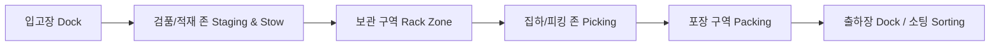

# [Chapter 1] 회사 소개 및 물류센터(FC) 개요

## 1.1 센터 비전 및 핵심 가치
- **정확성(Accuracy)**: 고객에게 약속된 상품을 정확하게 전달합니다.
- **신속성(Speed)**: 최적화된 동선과 스마트 물류 시스템을 기반으로 정시 출고를 실현합니다.
- **안전 제일(Safety First)**: 어떠한 생산성 지표보다 작업자의 안전과 건강이 최우선입니다.

## 1.2 물류센터 전체 조감도 및 구역 구분

- **입고(Inbound) 구역**: 벤더사 차량 접안 및 팔레트 단위 하역/검품
- **보관(Storage) 구역**: 랙(Pallet/Mezzanine Rack) 보관 및 자동화 설비 구역
- **출고(Outbound) 구역**: 오더 피킹(Picking), 패킹(Packing), 오토배거(Auto Bagger) 운영 구역
- **분류 및 상차 구역**: 권역별 소터(Sorter) 및 최종 간선 차량 적재 Dock
- **편의 및 관리 구역**: 휴게실, 안전보건실, 중앙관제센터(TOC), 사무동

## 1.3 기본 근무 수칙 및 복장 규정
- **복장 규정**:
  - 안전화 필수 착용 (미착용 시 작업장 진입 불가)
  - 반사 조끼(High-Visibility Vest) 및 명찰 패용
  - 헐렁한 옷, 긴 목걸이, 늘어진 끈 금지 (기계 끼임 방지)
  - 긴 머리는 안전모 또는 헤어망 안으로 단정히 묶을 것
- **반입 금지 물품**:
  - 개인 전자기기 (중앙관제 승인 기기 외 스마트폰 현장 휴대 제한)
  - 커터칼(개인용) 금지 (반드시 센터 지급 안전칼만 사용)
  - 라이터, 인화성 물질, 유리병 음료
