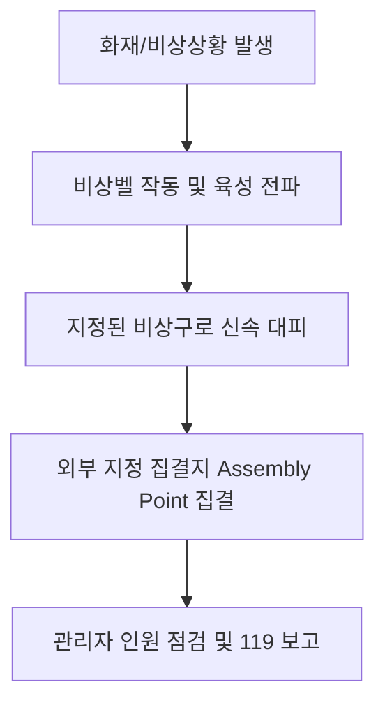

# [Chapter 2] 안전보건 가이드 (Safety First)

> [!CAUTION]
> 지게차와 작업자의 동선 분리는 생명과 직결됩니다. 반드시 보행자 전용 통로(Green Zone)로만 이동하십시오.

## 2.1 지게차 및 중장비 안전 수칙
- **보행자 통행 규칙**: 녹색 보행로 준수, 교차로 진입 시 **'좌우 확인 후 지적확인'**
- **안전 반경 유지**: 작업 중인 지게차 및 리치 트럭 반경 **3m 이내 접근 절대 금지**
- **사각지대 경고**: 코너 미러(볼록거울) 확인 및 경광등/후진 알람 주의

## 2.2 중량물 취급 및 근골격계 예방 작업 지침
1. **중량물 취급 3원칙**:
   - 단독 리프팅 한도: 남성 20kg 이하, 여성 15kg 이하
   - 초과 중량물: 반드시 2인 1조(Team Lift) 또는 운반 대차(Hand Pallet) 활용
2. **올바른 들어올리기 자세**:
   - 물건에 몸을 최대한 밀착
   - 허리를 펴고 무릎을 굽힌 상태에서 하체 힘으로 기립
   - 몸을 비틀면서 들어 올리지 말 것

## 2.3 비상 대응 및 화재 대피 요령

- **소화기/비상정지버튼(E-Stop)** 위치 숙지 (컨베이어 라인마다 5m 간격 배치)
- 비상구 주변 1m 이내 상품 적재 절대 금지
