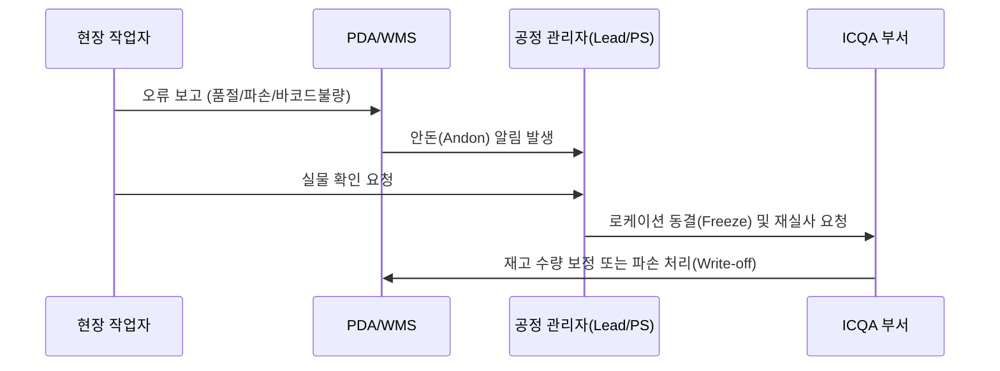

# [Chapter 6] 재고 관리(ICQA) 및 예외 처리

## 6.1 ICQA(Inventory Control & Quality Assurance)
- **주기적 순환 실사(Cycle Count)**: WMS 로케이션과 실제 재고의 일치율(Net Accuracy) $99.8\%$ 이상 유지
- **유통기한 모니터링**: 잔여 소비기한 30% 이하 품목 조기 격리(Quarantine)

## 6.2 오피킹, 파손, 분실 발생 시 프로토콜

- 임의로 다른 위치의 상품을 가져가 대체하는 행위 엄격 금지 (재고 왜곡 원인 1위)
